<!-- SPDX-License-Identifier: GPL-2.0-or-later -->
<!-- SPDX-FileCopyrightText: Copyright (C) 2026  ensqsqed contributors -->

# ensqsqed

A terminal browser for the **Ensoniq SQ-R Plus** — its 340 sounds, and
the reason a program change on this machine is not a program change.

Sibling to [rxved](../rxved) (Roland XV-2020), [kwsed](../kwsed) (Korg
Wavestation SR), [p2ked](../p2ked) (E-MU Proteus 2000),
[x5ded](../x5ded) (Korg X5D/X5DR) and [nanosyned](../nanosyned) (Alesis
NanoSynth), and it follows their conventions.

## ⚠️ Use at your own risk — back up first

ensqsqed is provided **as is, with absolutely no warranty and no
liability** for data loss or **hardware damage**. You assume all risk.
Full terms: [DISCLAIMER.md](DISCLAIMER.md).

Before you use this software, **make good, current backups of all your
files** — and of any existing banks on your instrument and storage media.
These tools can write to hardware and storage media; a mistake, a bug, or
untested output could overwrite or corrupt data, or be rejected by
hardware. Always test on a spare unit or emulator **before** connecting
irreplaceable equipment.

## The thing this exists to get right

The SQ-R has four groups of 80 sounds and 20 drum kits. It has no Bank
Select. **The group is chosen with a program change:**

| MIDI program change | what it does |
|---|---|
| 0–79 | a sound *in whatever group is in force* |
| 80–99 | one of the 20 drum kits, always |
| 123 | the next program change brings its effect too (MULTI) |
| 124 / 125 / 126 / 127 | from now on: Internal / ROM / Card A / Card B |

So a program change means nothing on its own. It means whatever the last
selector said — which may have been sent by somebody else, or by nobody.
`sqcli select INT 42 --dry-run` prints exactly what has to go out to
land on one sound, and the browser always sends the selector first.

The unit shows sounds as **00–79**, two digits and counted from zero —
measured on the unit, not taken from the manual's 001–128 wording. That
is also the program change it sends, so the display number and the wire
number are the same; nothing converts between them silently.

## Install

You need **git** and **Python 3.11+** — on Debian/Ubuntu, `sudo apt
install git python3-venv`. Then:

```sh
git clone https://github.com/lentferj/ensqsqed.git
cd ensqsqed
python3 -m venv .venv
source .venv/bin/activate
.venv/bin/pip install -e .
```

That installs the two commands, `ensqsqed` (the browser) and `sqcli`
(the command line). No hardware is needed to look around:
`ensqsqed --demo` opens the browser on invented sounds. To talk to the
real unit, plug it in over MIDI and start with `ensqsqed` — it finds
the ports itself and remembers them.

Needs `python-rtmidi` and `textual`, plus **vinsynlib** —
the shared base of this family of terminal instrument tools: the settings
cache, the keymap and legend, the command line and the port listing. It
comes from PyPI with the rest. To develop against a *working copy* of it
instead of the published one, install that alongside — it shadows the
published version in this environment only:
`.venv/bin/pip install --no-deps -e ../vinsynlib`.

## Running it

The terminal browser itself — what most people want:

```sh
ensqsqed                              # the browser; remembers port and channel
ensqsqed --demo                       # look around with no hardware attached
ensqsqed --allow-write                # start with the write gate armed
```

`sqcli` is the same program's command line, for scripting and one-shot
reads and writes. If the environment is not active, use
`.venv/bin/sqcli`; `python -m ensqsqed.cli` is the same entry point.

```sh
sqcli groups            # the groups and their selectors
sqcli list ROM          # every sound in a group
sqcli select INT 42 --dry-run   # what a DAW must send
sqcli select INT 42 --yes      # send it to the unit
sqcli read dump.syx     # read a .syx, .mid, .sqs or .lib file
sqcli status            # ask the unit what it is on
sqcli names             # all 80 internal names (silent)
```

The browser and the `status`/`names` commands need the instrument.
Pass `--port` and `--device-channel` the first time; both are remembered. If the unit's
MIDI IN and MIDI OUT are on different ports of a multi-port interface —
a crosswise cable — also pass `--recv-port`, or let the sweep find the
pair (it listens on every input of an interface while each output
sends). Without a remembered pair the sweep tries sixteen base channels
on every port, which takes minutes; the channel given by
`--device-channel` is tried first.

`read` takes all of them, and the two dump formats deliberately: a `.mid`
in this collection held a message its matching `.syx` did not. A `.sqs`
file is the exception to "a dump": it is read for the Ensoniq SysEx
sounds embedded in it. A `.lib` SoundDiver library is read for its sound
records only; SoundDiver's settings and global data are ignored.

## What it does

ensqsqed is a terminal browser for the Ensoniq SQ-R Plus that displays
the two numbers that actually select a sound — the group selector
(124-127) and the program change (0-79) — on every row, plus a local
favourites database with ratings, tags and notes.

- **Two panes: groups on the left, that group's sounds on the right.**
  The SQ-R has no Bank Select. The group is chosen with a program change
  (124=Internal, 125=ROM, 126=Card A, 127=Card B), and every later
  program change means whatever that one said until the next. The browser
  always sends the selector first. The slot pane now shows `#` (the
  slot's position in its group, counted from 0, matching the panel's
  **00–79** display; **00–19** for drum kits), `PC` (the actual MIDI
  program change the unit sends — **00–79** for sounds, **80–99** for
  drum kits)
  and `sel` (the group selector — this instrument's replacement for
  the siblings' LSB/MSB columns, `—` for a drum kit, whose program
  change is absolute). Screenshots in this README predate the restored
  `PC` column.

- **Names come off the unit and persist.** Only Internal has a bank
  dump: `r` reads all eighty sounds in one silent message, and the same
  read runs quietly at startup, so a fresh install shows names rather
  than blanks. What it reads is kept in a sidecar beside the catalog, so
  the next launch opens on them immediately. ROM, Card A/B and the drum
  kits have no bank dump: `r` on those groups reads them one selected
  sound at a time and asks first; `S` does the same for all of them in
  one run, and a second `S` stops it. `R` empties the catalog
  (favourites, ratings, tags and notes are untouched).

- **Favourites with ratings, tags and notes**, in a SQLite database in
  the platform's own application-data directory — so a `git clean` in a
  checkout cannot take it. Rate with `*` (0-5), filter with `V`, tag
  with `t`, note with `n`, cycle views with `v` (all slots / bank
  favourites / all favourites).

- **Category filter** (`C`): narrow the list by the instrument's patch
  categories. Ratings and categories stack: "soft pads I rated 4+" is
  one filter over another.

- **Search** (`/`): case-insensitive substring search over printed
  names, live names, tags and notes, with checkboxes to choose which
  fields.

- **Undo/Redo** (`z`/`Z`): reverse the last change (favourite, rating,
  tag, note, edit) or all changes. Single timeline, so `z` reverses
  whichever came last.

- **Write gate** (`w` / `--allow-write`): locked by default. Arm it to
  enable every write — browser edits, multi/fx edits, imports, backup
  restores, `R` renames and `ctrl+s` stores. It also works inside the
  editors and import windows, where a locked gate says so on that
  window's own status line.

- **Persistent UI state**: bank position, slot cursor, view mode, rating
  filter and category filter are remembered between runs.

- **Live names sidecar**: the names read off the synth are kept beside
  the catalog, so the next launch opens on them immediately.

- **Catalog and scan**: `R` rebuilds the catalog; `S` scans the device.

- **Channel** (`[` `]` then `c`): step the base channel and set it.
  The browser always sends the selector first, so a channel change is
  heard on the next selection.

- **Backup screen** (`b`): choose sound groups and content
  (sounds/presets/all) and write the backup; restore is `sqcli restore`.

- **Remote window** (`ctrl+o`): mirrors the panel, ungated — arrows,
  entry keys, System/Effects/Track pair, Select/Edit row and
  Copy/Compare. Details are in the MULTI section below.

- **Warm preset cache**: the preset bank is read once in the background
  after launch, so `p` usually opens on a warm list.

- **Mode toggle** (`M`): toggles the unit between SELECT SOUND and
  SELECT PRESET.

- **Device info** (`i`): asks the unit which sound it is on and shows
  connection, channel, catalog and favourites counts.

- **Help** (`?`): shows the help screen.

- **Keys** (the legend wraps, never truncates):

  ```
  ↑↓ move
  tab pane
  ⏎ select on the unit
  r read names
  / search
  [ ] channel
  c set channel
  f favourite
  v favourites view
  * rating
  V rating filter
  C category
  m multi tracks
  x effect
  p preset list
  I import
  b backup
  M mode (sound / preset)
  t tags
  n note
  z undo
  Z undo all
  w write gate
  S scan device
  R rebuild catalog
  i device
  ? help
  ctrl+o remote
  q quit
  ```

### Screenshots

The screenshots below were captured from the real SQ-R Plus over MIDI
with `tools/capture_screenshots_hw.py`: four silent reads (internal
names, current sound, current preset, all eighty presets) are
snapshotted once, then the app is driven headlessly against that
snapshot — no port stays open during the capture, nothing is sent, the
write gate stays locked, and the unit's selection and memory are
untouched. Sound names are the unit's own Internal bank; preset names
are the unit's own. Track sound names read "(no name)" here because a
fresh checkout has no sound catalog — names for the other groups come
from a catalog file or not at all.

The single-sound preview screenshot is a demo-mode capture, so its file
names are invented; it is included to show the preview controls.

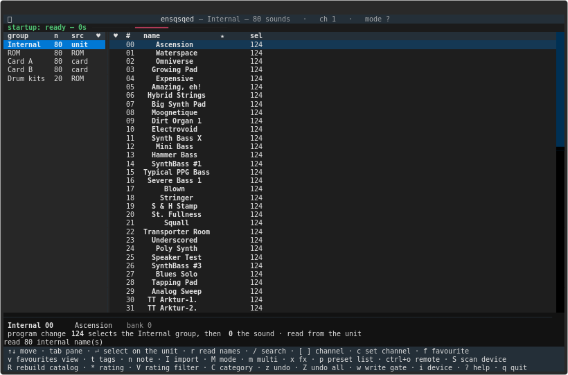

Browser view: groups on the left, that group's sounds on the right,
with the group selector and slot number on every row. The Internal
names were read off the unit.

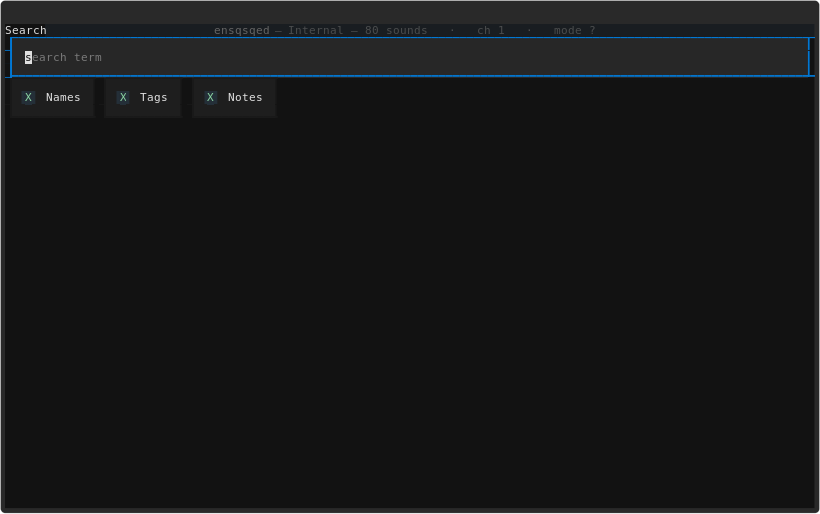

Search overlays the list with checkboxes for which fields to match.

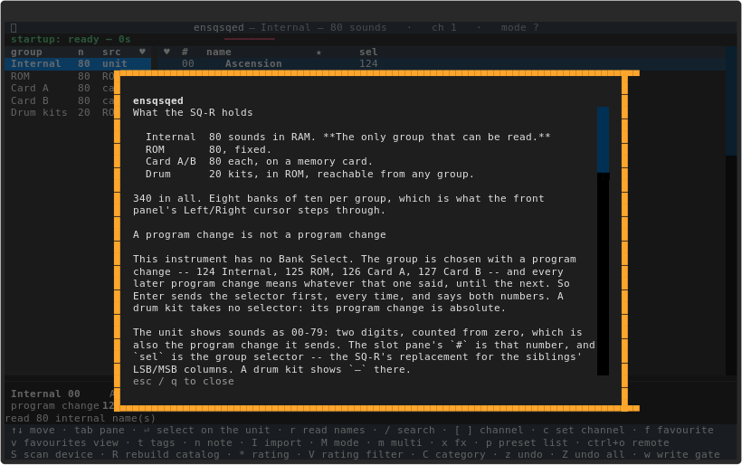

Help screen listing the keys.

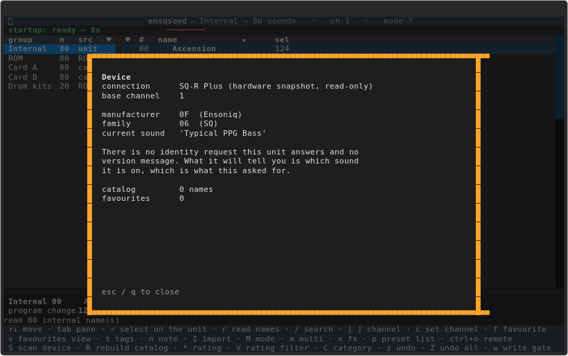

Device information screen.

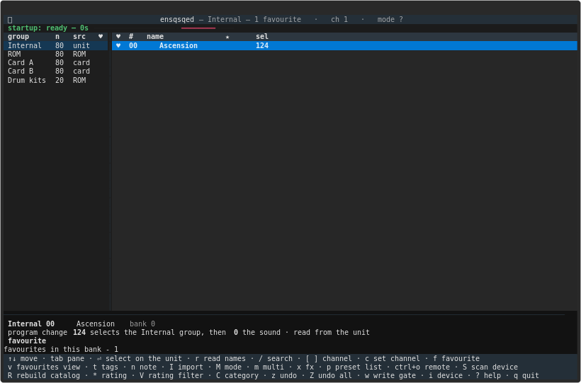

Favourites view.

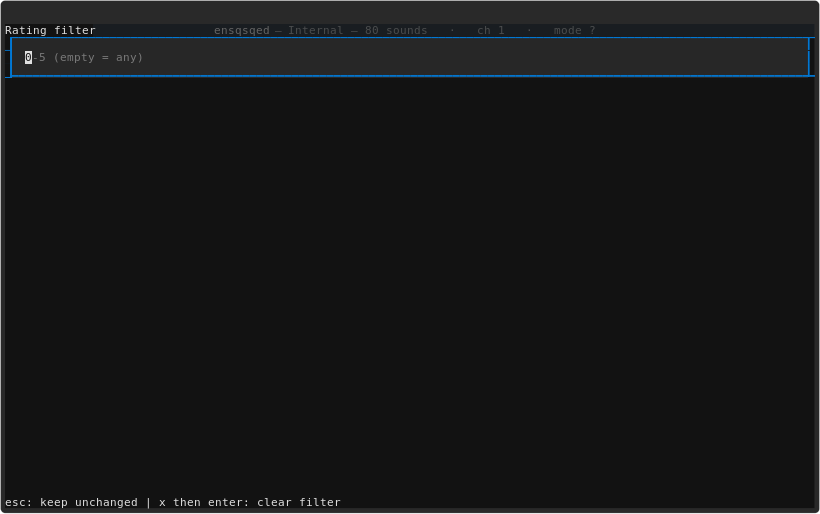

Rating filter.

## MULTI mode & presets

The browser finds and selects sounds. A **preset** is the other thing the unit holds: a performance setup of eight tracks — each with its own sound,
mix, key range and MIDI settings — and one effect that all eight share.
The SQ-R's MULTI mode is the panel's reading of that: each track that is
on receives on its own MIDI channel, and a track that is off does not
receive at all. Three keys reach it.

- **`p` — the eighty presets.** Reads them all in one message (about
  twelve seconds, and it says so), lists them by the unit's own number
  and name, and **`⏎` selects the row's slot on the unit** before the
  editors open over it. The app sends Select Preset, then a Program
  Change; when the Program Change does not take (Preset Prog OFF, or the
  receiver ignores it), it falls back to stepping the selection with the
  panel's next/previous keys and verifies the slot byte. **The same bank
  is read once in the background after launch** (non-blocking, on a
  worker), so `p` usually opens on a warm list; a read older than a
  minute is taken again. **`p` also works inside the MULTI editor**: the
  list opens over it, and a pick replaces the editor's preset in place
  (cancelling returns to the editor).
- **`m` — the eight-track editor.** The preset's eight tracks as a table.
  `⏎` on a track's sound opens a browser with **all five groups** —
  Internal, ROM, Card A, Card B and the drum kits — so a multi setup can
  mix sounds from anywhere the unit holds them, not just the bank the
  browser is on. `v` steps the same three favourites views the browser
  has: all sounds, this group's favourites, every favourite across groups
  (shown as `INT 003`, `CARDA 007`, …).
- **`x` — the effect editor.** The preset's one effect.

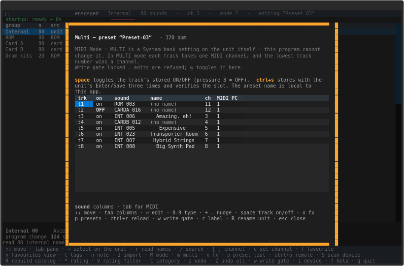

The eight-track editor.

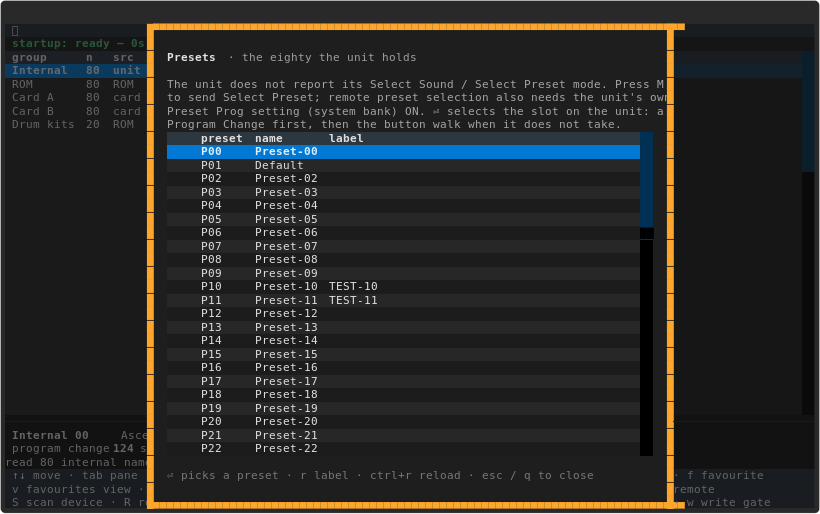

The preset list: the unit's own numbers and names, as read off the
hardware. `⏎` selects the row's slot on the unit.

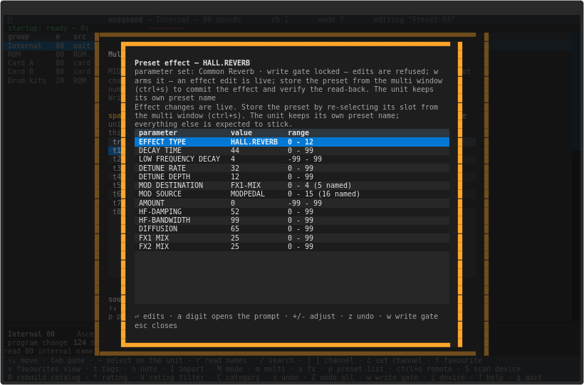

The effect editor.

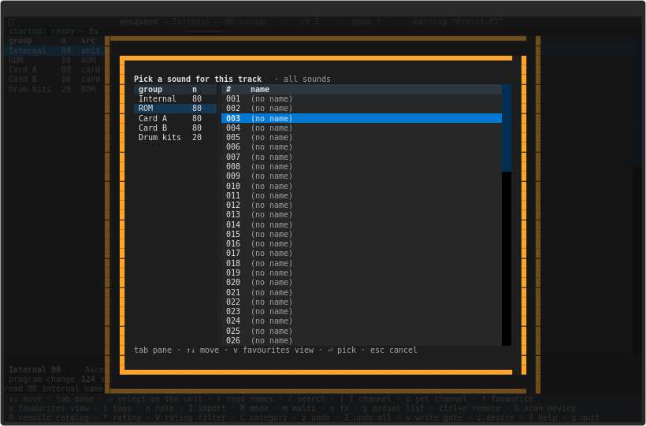

Sound picker opened from a track (all five groups). Names resolve from
the catalog; a fresh checkout shows numbers until one is provided.

The track editor's columns are grouped, and `tab` cycles the groups the
way rxved's does. Two columns are in every group — `trk`, the track's
own number, and `on`, the stored track marker — then:

| group | columns | what the panel calls them |
|---|---|---|
| **sound** | `spot`, `name`, `ch`, `program` | the sound — group and slot — its name, the **MIDI channel** it receives on (1-16), and the program change it answers to (1-128); the channel is here because eight tracks on eight channels is what MULTI mode is for |
| **MIDI** | `status`, `press`, `sustain` | Status BOTH/LOCAL/MIDI/*EXT*, Pressure NONE/KEY/CHANNEL/OFF, and the sustain switch |
| **MIX** | `vol`, `pan`, `timbre`, `rel`, `out` | Volume 0-99, Pan SOUND or -98..+99, Timbre 0-99, Release -64..+64, Output DRY/FX1/FX2/VOICE/CONTROL |
| **KEY** | `low`, `high`, `transp` | the key range as note names (A0..C8) and the transpose (octave and semitone) |

**`space` toggles a track on or off in the stored preset** — the
`on` column shows the state. Any track can be off, including track 1
and all eight at once. Storing (`ctrl+s`) writes the whole preset, so
an on/off change goes with it. How the marker is encoded is in
`docs/PRESET-FRAMING.md`.

`⏎` edits the cell under the cursor — a list to pick from when the
values are words, a number to type when they are numbers — a digit
starts that number, and `+`/`-` nudge it.

**`ctrl+s` stores with the unit's Enter/Save ×3.** The manual's
front-panel store is Enter/Enter/Enter → *SAVED*; the app sends those
three presses and then walks to the neighbouring slot only to read the
stored bytes back, walks back and verifies the slot against the unit's
edit buffer. `E` is not needed and is gone.

**`ctrl+r` reloads from the unit.** It steps the selection through all
80 presets (about a minute, audibly) and reselects the slot, so the
track arrangement — which a dump stores but does not make live — takes
effect. **`ctrl+shift+s` is the store assist**: pick a backed-up slot
on the panel, confirm, and the app sends those bytes to the selected
slot with a verified retry.

**`R` renames on the unit.** The app asks for the new preset name — max
16 printable ASCII — and drives the unit's save-dialog name page (cursor
buttons and **Enter/Save**) and stores to the selected slot, storing the
current edit too if there is one. The app's edits are SysEx dumps, so
the save dialog asks `Replace edit preset?` and `R` loads the working
preset first; if the panel itself has an un-stored edit, store it with
`ctrl+s` first. **`r`** remains the app's local label for the preset,
kept in the `preset_labels.json` sidecar. A successful rename updates
the MULTI title and the cached preset browser from the read-back
immediately; no reload is needed.

**`[` and `]` move the panel's track cursor.** They send the Track
keys singly; the unit's display is the cursor's readout, which the app
cannot see.

The effect editor lists the thirteen effects by the panel's own names
(CONCERT REVERB … CMPRSS+DIST+VERB), then the parameters of the active
set, the FX1/FX2 mix, and the modulation destination/source/amount. The
rows come from the model, not from a hand-written list, so a byte that
holds two parameters (the modulation destination and source share one)
is two rows that each mask the bits they own.

**A change is sent as a whole preset** — the sequence data and the 168
bytes of the preset — because this protocol has no field-level write.
The unit stores it into its **currently selected slot** (the display
shows *Edited Preset* transiently; no panel ENTER/SAVE is needed for a
dump — ENTER/SAVE is still what stores *panel* edits). The write gate
(`w`) must be armed first, and every change is read back and compared
byte for byte — a refused or unmatched write is reported, not assumed.
What the store writes (measured 2026-10-24): the tracks and pile, and
the effect **parameters** (offsets 152–161). The unit keeps its own
preset name; **re-selecting the preset** commits the live effect
parameters, while the panel's ENTER/SAVE dialog did not store a sent
effect in the test. `ctrl+s` performs that re-selection and verifies the
read-back; the confirmation is green.

**The send is live for the sound's levels; the track arrangement needs a
reload.** Ear-verified on the unit on 2026-10-23: a volume send is heard
immediately (127 audible, 60 "a lot lower", 20 silent, each after the
verified send and past any settling time), while the track on/off — the
status byte set to *OFF*, or a track removed from the pile — is **not**
heard: all eight tracks set to OFF still played, before and after a
reload. Level-side changes therefore reach the playing engine; the
arrangement is stored and takes effect when the preset is **reloaded**.
A reload is a preset-select event, which the app can force remotely: the
reload action steps the unit's selection through all 80 presets (about a
minute, audibly) and reselects it. (An earlier paragraph here quoted
readings from an audio capture that turned out to be broken — it
reported the same saturated level for audible and inaudible notes — so
those numbers are withdrawn; the 2026-10-21 "the send is live" record
was right about the levels for the wrong reason.)

**Storing is remote now.** The app sends that slot's backed-up bytes and
the unit stores them — the display's *Edited Preset* is transient and
the unit keeps its own name. Panel edits still go through the manual's
six steps: check that the Edit Preset is displayed, press
**ENTER/SAVE** ("Save Preset \<name\>?"), optionally edit the name with
the cursors, press **ENTER/SAVE**, pick the slot with the cursors,
press **ENTER/SAVE** again — the display says *SAVED*. A double-click
on ENTER/SAVE stores to the same slot in one step. The store path itself
is the whole-preset dump behind the write gate (`w`), byte-verified;
sending a stored slot's own bytes back is idempotent safe. Per-track
on/off via stored bytes is reachable this way: `space` toggles the
stored marker and `ctrl+s` stores it.

**A remote window (`ctrl+o`) mirrors the panel, ungated.** The left
cluster holds the arrows and the entry keys, the right cluster the
System/Effects/Track pair, the Select/Edit row and Copy/Compare. Every
button on screen is also a PC key in the same physical place, and the
mapping is layout-immune — only keys that sit identically on QWERTY and
QWERTZ are used (a 3x2 block Q/W/E over A/S/D beside a 4x2 block
U/I/O/P over H/J/K/L; Space for the Track pair). The four mode
keys are buttons 1-4 in panel order (Select Sound, Select Preset, Edit
Sound, Edit Track); Bank Select is 0, System is 11, Effects is 13, and
YES/NO are the Up/Down keys (7 and 5). Copy Effect and Compare are
secondary functions (of Select Sound and Edit Sound), not keys of their
own. **`m` (or the browser's `M`) toggles the unit between SELECT
SOUND and SELECT PRESET** — buttons 1 and 2 on one key. The unit does
not report which mode it is in, so the app remembers the last one it
sent, shows it in the header, and keeps it when the window is reopened.
The key map and the caveats are in `docs/KEY-MAP.md` §5.

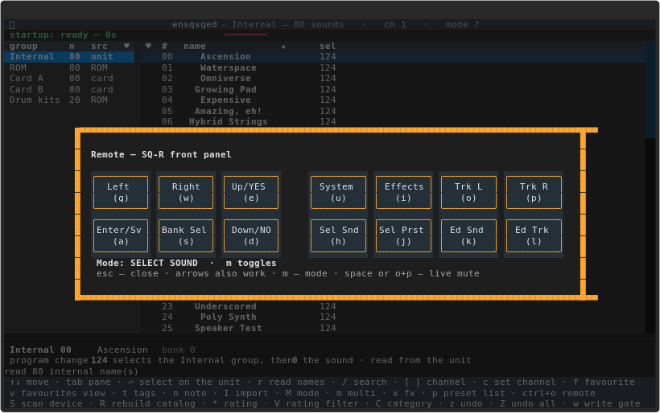

Remote control window mirroring the panel.

`w` works **inside both editors** as well as in the browser — a modal
screen cuts the browser's key chain, so the editors serve it themselves
and toggle the one gate the write path checks. The editor's own note
line says whether the gate is armed, and a refusal is said on the
editor's status line, not on the dimmed browser behind it.

Two MULTI rules are worth knowing, and both live on the unit:

- **MIDI Mode=MULTI is a setting in the unit's System bank**, not a
  message this program can send. Set it on the unit; the screen says so
  where it matters.
- **Never put a track on the base channel while Preset Prog is ON**, and
  give one track per channel — the lowest track number wins a channel.

**What this deliberately does not do.** It does not decode the 21-byte
global block or the trailing bytes of the ten 54-byte sequence blobs —
the dumps do not exercise them, and `docs/RESOLUTION_NOTES.md` says so.
It does not change what the unit is playing by moving the cursor: reading
is silent. The remote window *is* the panel gesture the app drives;
permanent per-track on/off goes through the cooperative store above.

### Backing the unit up, and putting a backup back

**Take a backup before this program writes anything.** Two commands,
both silent reads:

```sh
sqcli presets --all --out presets-all.syx   # all eighty stored presets
sqcli multi --out current.syx               # the one the unit is on
```

`presets --all` writes one message, about 36 KB — the whole memory.
`send` will refuse that file, because a whole memory is not a preset; to
put a single slot back, take it out on its own:

```sh
sqcli multi --preset 12 --out slot-12.syx   # one slot, in the form `send` takes
```

**Sounds restore to Internal only.** A card is copied from Internal on
the front panel; the app deliberately does not offer Card A/B as a SysEx
write target for imports or restores.

**What a restore writes, and what it does not.** A dump stores the
selected slot's **track/pile range, offsets 32–151** — that includes
each track's pressure (the stored ON/OFF), so the arrangement is
restored. It does **not** write the effect block (152–162) or the name
(2–17): the unit keeps its own name, and the effect needs the panel's
**ENTER/SAVE** (or the app's `ctrl+s`) to be stored from the working
buffer. A dump restore does not write the name — the unit keeps its own
— but the app can now rename on the unit with `R` in the multi editor,
which drives the unit's save dialog and stores to the selected slot. The
app's local preset labels are a sidecar (`preset_labels.json`), not part
of the unit dump, so a dump restore does not bring them back. A backup
taken while the unit is on a slot with an un-stored edit captures that
slot's working preset; take the backup with no un-stored edit, or store
first. Any restore of the all-presets dump must use the dump's slot
table (`slot = (idx + 70) % 80` on this unit), not `presets_raw[slot]`.

**Local labels are backed up too.** A presets/all backup writes
`preset_labels_<stamp>.json` beside the dump (the app's backup screen
and `sqcli backup` both do). Restore it with
`sqcli restore preset_labels_….json`; that is app-side only and does not
touch the unit. The unit's own preset names are not written by a dump; a
real rename of the unit is the app's `R` key in the multi editor, which
drives the save dialog. Local labels are a separate sidecar from that
name.

**Putting a single preset back is cooperative.** The owner selects the
slot on the unit's front panel; the app sends the backed-up bytes; the
unit stores the track/pile range. The effect block needs the panel's
ENTER/SAVE:

1. `sqcli send slot-12.syx --yes` — the track/pile range is stored into
   the selected slot; the dump is read back and compared byte for byte
   (verify=True, bounded retry).
2. On the unit, panel edits still go the manual's way: **ENTER/SAVE** →
   confirm the name → pick the slot with the cursors → **ENTER/SAVE** →
   the display says *SAVED*.

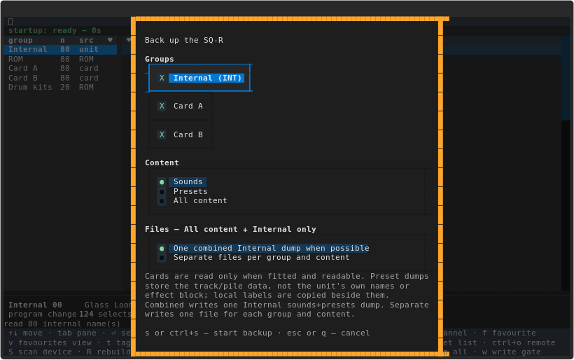

Backup screen.

## Importing banks and sounds

`I` opens a **file browser** (it remembers the folder you last loaded
from, never the file) and reads an **All-Sounds dump** — the 32647-byte
`.syx`, the `.mid` that carries the same SysEx, a SoundQuest `.sqs`
favourite bank, or a SoundDiver `.lib` sound library. A `.sqs` file
contributes only the Ensoniq SysEx sounds embedded in it; its
SoundQuest-native records are ignored, and the sounds from all its banks
are collected into one import list. A `.lib` file contributes only its
sound records; SoundDiver's settings and global data are not imported.
It writes **Internal (RAM) only**: a card is copied from Internal on the
front panel, not written by SysEx. **`ctrl+s` starts either flow**; the
preview screens show a progress line, and a long bank read or write is
covered by a "please wait" screen.

- **Whole bank** previews every sound in the file by number and name,
  then sends it to Internal.
- **Single sounds** opens a two-pane map. The left pane lists the file's
  sounds with a `target` slot beside each; `⏎` on a row (or typing a
  digit) asks for a target slot from `00` to `79`, and target slots must
  be unique — a duplicate or out-of-range slot is refused with a
  sentence and nothing is written. `ctrl+s` starts the import. Slots you
  do not assign are left alone.

**Preview while you assign.** The map can audition a source sound before
any target is assigned. `l` sends the focused sound as a Single Sound
Dump to the current **Edit Sound buffer**; it does not select a slot,
write a bank, or change the stored Internal bank. Two options are opt-in
and start off:

- **Auto-load on focus** sends the focused sound after a short debounce
  as the cursor moves.
- **Autoplay after preview load** plays a short three-note phrase after
  the load. Note-offs and CC 123 are sent even if the phrase fails.

For auto-rehearsal, set the unit to **POLY or OMNI on its System MIDI
base channel, not MULTI**. The app cannot read or change that setting;
it is set on the unit. Previewing is not a permanent import: assign
targets and press `ctrl+s` when you are ready to write.

**Cards are copied on the unit.** To put a bank on Card A or Card B,
import or restore it into Internal first, make a current Internal backup,
then use the front panel's card copy. The app deliberately does not offer
a card as a SysEx write target.

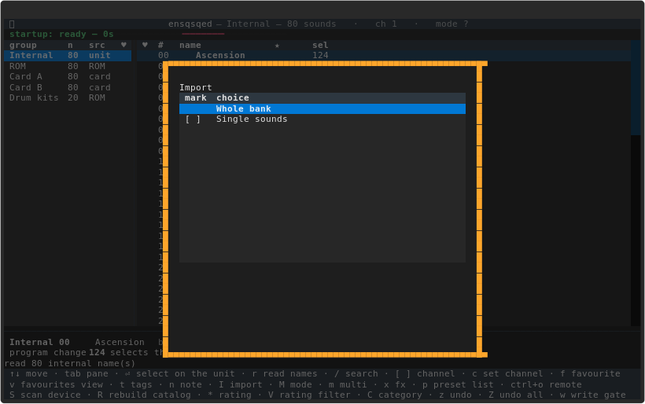

Import screen (single sounds, target slots).

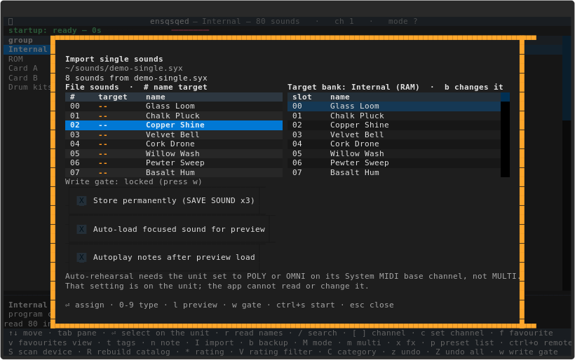

Single-sound map with the preview options. Both checkboxes start off;
`l` previews the focused sound in the Edit Sound buffer without a target
slot or a stored write.

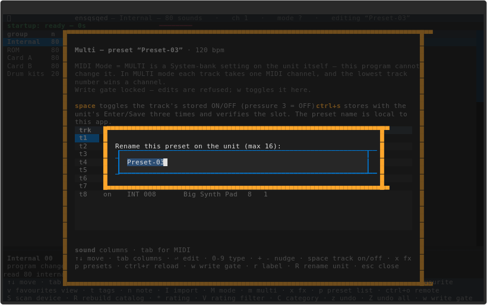

Rename prompt (on-unit rename).

**Nothing is sent without the write gate and two confirmations.** Arm
the gate with `w` (or launch with `--allow-write`). **`w` also works
inside both import windows**, so a locked gate says so on the window's
own status line and your file, bank and target assignments are kept; arm
it there and press `ctrl+s` again. The first confirmation names the bank
and the number of sounds; the second names what is overwritten. The gate
is checked again between the second answer and the wire.

**Permanent store is opt-in.** By default a type-02 Single Sound Dump
is accepted into the **edit buffer** — the sound is live — but the
stored bank is unchanged. Check **Store permanently (SAVE SOUND x3)**
in the single-sound map and the app sends each sound, then drives the
unit's SAVE SOUND: **three Enter/Save presses**, verified by reading the
stored Internal bank (measured 2026-10-27). The panel's SAVE SOUND is no
longer needed for that path; without the checkbox the import still
reports "loaded into the edit buffer, not stored".

The 32647-byte type-03 All Sounds Dump is rejected by the ALSA port
here, so the whole-bank flow falls back to per-slot sends.

**After a whole-bank send Internal is reread** by its one dump, so the
browser shows what is now in RAM without a restart.

**Only Internal RAM is readable**, so an INT write is compared byte for
byte and reports the difference. Card A and Card B are not dumpable and
are not write targets here: read them for backup by selecting each sound,
then copy a bank to a card on the unit's own panel. Take a backup before
importing over Internal.

The hardware suite pins the measured behaviour behind a second,
destructive gate:

```
ENSSQSQED_HW_BANK_WRITE=1 .venv/bin/python -m pytest tests/test_hardware.py \
    -k SoundBankWrite --hardware
```

The dump-only edit-buffer write passes; "stored in the bank" by a dump alone
is a **strict xfail**. The opt-in permanent store is the measured
three-Enter/Save path and is verified separately against the stored bank.

## Command line

```sh
sqcli groups            # the groups and their selectors (no device needed)
sqcli list ROM          # every sound in a group (no device needed)
sqcli find NAME         # search names (no device needed)
sqcli fav --add INT:1   # the favourites database (also --remove/--tags/--note/--rating)
sqcli tags              # tags in use, with counts
sqcli select INT 42 --dry-run   # what a DAW must send
sqcli select INT 42 --yes      # send it to the unit
sqcli read dump.syx     # read a .syx, .mid, .sqs or .lib file
sqcli status            # ask the unit what it is on
sqcli names             # all 80 internal names (silent)
sqcli hardware          # what the unit reports about itself
sqcli channels          # every MIDI channel, and what it selects
sqcli multi                        # the eight tracks of the preset the unit is on
sqcli multi --preset 12            # one of the eighty stored presets (reads all of them)
sqcli multi --out p.syx            # write the raw dump (the wire bytes `send` takes)
sqcli presets                      # the current preset as .syx (silent)
sqcli presets --all --out presets-all.syx   # all eighty, as .syx (silent)
sqcli backup --groups INT --content sounds   # backup sounds/presets/all to a file
sqcli restore backup.syx --yes     # WRITE a backup back (gate: --yes)
sqcli dump bank | dump sound INT 1 # dump the internal bank / one sound
sqcli send preset-current.syx --yes   # WRITE it into the unit's selected slot
```

`sqcli backup`/`restore` are the command-line side of the backup screen
(`b`); `sqcli send` refuses a whole-memory dump — take a single slot
out with `sqcli multi --preset N --out slot-N.syx` first.

## What it knows

Ensoniq's **MIDI System Exclusive Implementation Specification v1.43**
covers the SQ-1 family and says the SQ-R recognises the same header.
`sq/messages.py` is transcribed from it and checked against 116 dump
files. See `DISCLAIMER.md` for what is verified and what is not, and
`docs/RESOLUTION_NOTES.md` for how each thing was established.

## Development checks

The toolchain is pinned in `requirements-dev.txt`. Create the virtual
environment with `--system-site-packages` so the system `python-rtmidi`
and `textual` are visible, then install and run everything:

```
python3 -m venv --system-site-packages .venv
make bootstrap        # project + pinned toolchain + pre-commit hooks
make check            # ruff, mypy, pytest + coverage, pip-audit, vulture,
                      # deptry and detect-secrets, in that order
```

`make help` lists the individual targets (`lint`, `format`, `typecheck`,
`test`, `audit`). `make check` fails on the first problem. It passes on
the current tree because every pre-existing finding is baselined or
ignored narrowly rather than switched off: see
`docs/QUALITY_CHECKS.md` for what is suppressed, why, and the few items
worth fixing outright. Formatting is enforced too — `make lint` runs
`ruff format --check`, and `make format` rewrites files when the check
complains.

## Licence

GPL-2.0-or-later. AI assistance was used; see `DISCLAIMER.md`.

## AI assistance & human authorship

ensqsqed was built by its human author together with AI assistance. The
**ideas, the project vision, and every feature** came from the human
author; AI assisted with **writing the code and analyzing the binary
formats**. Crucially, the **reverse engineering rests on hands-on human
work** — all testing and verification on real hardware, creating the
reference images/banks on those instruments (disk saves, SysEx probes),
and aural A/B comparison of presets — which is what makes the results
correct. Full account in [DISCLAIMER.md](DISCLAIMER.md).

## Support this project

ensqsqed is free software and always will be. Nothing is behind a
paywall, no feature is withheld, and none of what follows changes that.

But if it has been useful — if it saved you an evening of mapping zones
by hand, or got a library onto a machine that had no way of reading it,
or **best of all, if it has your vintage instrument switched on and in
use more often than it was, and you are having more fun with it** — then
please consider supporting the work.

**Because here is what it has actually cost:**

- **Real machines on a real bench.** Much of what these tools know about
  these formats was measured on hardware rather than read anywhere,
  because for most of it there is nowhere to read it. That needs the
  machines — the instruments themselves — and it puts hours of wear on
  hardware that has been locked up and recovered more than once in the
  course of it. Some of these instruments were bought specifically to
  add and verify a format; the others were already here, because the
  person doing this is a vintage instrument enthusiast first and the
  projects exist because the instruments were in the room.
- **Dozens — realistically hundreds — of hours of human time.** Format
  reverse-engineering is slow: measure, be wrong, measure again. A
  single parameter law in this README can represent an evening at the
  bench.
- **AI assistance, which is a paid service**, used heavily throughout
  and not cheap at this volume.

**This is support, not a donation — and the distinction is a legal one,
not a turn of phrase.** The maintainer is based in Germany, where
payments like these are *not* `Spenden` in the tax sense: they count as
**taxable income** for the recipient and are **not tax-deductible** for
the giver. So this section is titled *Support*, deliberately, and no
receipt for tax purposes can be issued. (That is a statement of how it
is handled here, not tax advice.)

If the project saved you the work, you can support it through
**[GitHub Sponsors](https://github.com/sponsors/lentferj)** — the
*Sponsor* button at the top of the repository. Payment is handled
entirely by GitHub and Stripe, so bank and tax details are never handed
to the person paying.

**Support is not expected, and it is not the only currency.**

- **Bug reports** — ideally with the bank, preset or disk image that
  produced them. A tool's failures are usually specific to one file
  rather than general, and without that file they are very hard to
  reproduce.
- **Confirmations from hardware that is not on this bench**, which
  matters more here than for a single-machine tool. These tools write for
  whole *families* of instruments, and the bench holds only a subset.
  Whether a variant accepts what we write is genuinely unknown, and
  several notes say "on this unit" for that reason. A "loads fine here
  too", or a "no, mine refuses it", is worth a great deal.
- **Corrections to the reverse-engineering notes.** The wrong turns are
  recorded next to the findings in `docs/RESOLUTION_NOTES.md` —
  retractions included, because a finding that was withdrawn is as
  useful as one that stood. If any of it is wrong in a way that is still
  costing someone time, saying so improves the record.